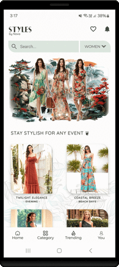
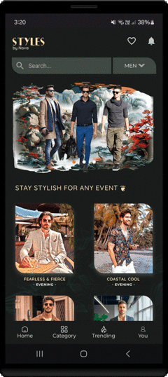
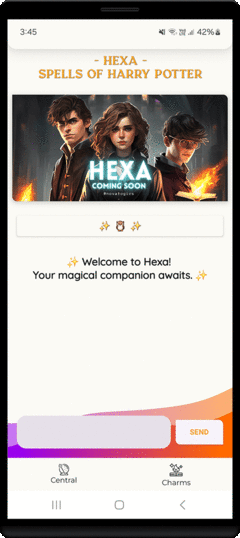
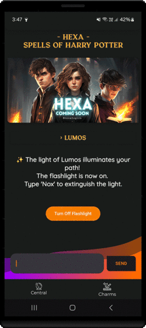

<!-- [1] : Seaction Header : Main -->
<h2 align="center">
 <strong> I go by Zyfer 𐂃༺ </strong><br> 
 𒄆 <em> >/ Rajitha Dissanayake </em> 𒄆
</h2>

<div align="center">
 <h3>
 Mobile Engineer&nbsp; ║ &nbsp;UI␥UX Engineer
 </h3>


𒆙 **Senior Software Engineer** with **6+** years of experience in mobile app development
<br/>

𒆙 Expert in **Native Android** and building cross-platform apps with **Flutter**, **React Native** and **Ionic**
<br/>

𒆙 Skilled in using design patterns like **MVI**, **MVVM**, and **BLoC** to create clean and efficient apps

 <!-- [1.1] : Seaction Header : Ranking-->


 <sub>║│█║▌║▌║▌│█║▌║▌║▌│█║▌║▌║</sub>


 <details>
 <summary> 𒄆 ᴘᴜʙʟɪᴄ ᴄᴏɴᴛʀɪʙᴜᴛɪᴏɴ ʀᴀɴᴋɪɴɢ 𒄆<br/>< ꜱʀɪ ʟᴀɴᴋᴀ ></summary>

```yaml
https://committers.top/sri_lanka.html
```

</details>


</div>

##

<div align="center">

[]()
[]()

<!-- <br/> -->

</div>

##

<div align="center">

<details>
<summary> ᴛᴇᴄʜ ꜱᴛᴀᴄᴋ / ꜱᴋɪʟʟꜱ  </summary>
<br>

| **Technical Skills** |
| - |
| **Languages & Technologies:** <br> Android (Java, Kotlin), Flutter (Dart), React Native (JS), C#, Swift, <br> Java SE, RxJava, AIDL, Dagger, OpenCV, BLE, OpenGL                                          |
| **Tools & Software:** <br> Android Studio, IntelliJ IDEA, VS Code, Visual Studio, Unity (2D), Postman, Adobe CC                                                                                           |
| **Databases:** <br> MySQL, MS-SQL, SQLite, Firebase, Room DB                                                                                                                                              |
| **Android Architecture Components:** <br> Lifecycle-aware components, Compose (UI Toolkit), ViewModel, LiveData, Navigation, Hilt &nbsp; <br> View Binding, Data Binding, Room DB, WorkManager, DataStore |
| **Design Patterns:** <br> MVI, MVVM, MVP, MVC, Facade, Observer, BLoC                                                                                                                                     |
| **Version Control:** <br> GitHub, GitLab                                                                                                                                                                  |

 <br/>

</details>

 <br/>

[](#)
[](#)
[](#)
[](#)
[](#)
[](#)

[](#)
[](#)
[](#)
[](#)
[](#)
[](#)
[](#)

[](#)
[](#)
[](#)
[](#)
[](#)
[](#)
[](#)


</div>

##

<div align="center">

\- ᴜɴᴅᴇʀᴡᴀʏ ᴘʀᴏᴊᴇᴄᴛꜱ -

[𝐋𝐘𝐗𝐀  𝑳𝒊𝒗𝒆](https://github.com/ZyferLink/lyxa-live-flutter-app) &ensp; ✦ &ensp;
[𝐕𝐢𝐝𝐁𝐨𝐱](https://github.com/ZyferLink/vidbox-reactnative-expo-app)


<br>
<br>


[𝐒𝐓𝐘𝐋𝐄𝐒 𝚋𝚢 𝙽𝚘𝚟𝚊](https://github.com/ZyferLink/styles-by-nova-android-app) &ensp; ✦ &ensp;
[𝐇𝐄𝐗𝐀](https://github.com/ZyferLink/hexa-harry-potter-android-app)






</div>


##
<div align="center">

"*ᴛʜᴇ ʙᴇꜱᴛ ᴇɴɢɪɴᴇᴇʀꜱ ᴀʀᴇ ɴᴏᴛ 🇹​​🇭​​🇴​​🇸​​🇪​ ᴡʜᴏ ᴄᴏᴅᴇ ᴛʜᴇ ꜰᴀꜱᴛᴇꜱᴛ, <br/> ʙᴜᴛ ᴛʜᴏꜱᴇ ᴡʜᴏ ᴛʜɪɴᴋ ᴛʜᴇ ᴅᴇᴇᴘᴇꜱᴛ.*"

</div>

##

<div align="center">

<details>
<summary> <strong> Insights & Interests </strong> </summary>

<br/>

| [Name] <br> &nbsp; Shavinda Dissanayake &nbsp; | [Education] <br> &nbsp;&nbsp; BSc in IT from SLIIT, Sri Lanka &nbsp;&nbsp; | [Current Role] <br> &nbsp; Senior Software Engineer &nbsp; |
| :-: | :-: | :-: |

[]()

#

🌾  🌾🌾🪨🌾

| Interests                                                                                                           |
| - |
| 📜 **Commenting on Code Like a Poet** - _Because every line tells a story_                                          |
| 🐞 **Debugging Life Choices** - _Figuring out where it all went wrong_                                              |
| 🎨 **Code Commenting Art** - _Writing cryptic messages for future generations_                                      |
| ☕ **Coffee Compiler** - _Running on Java (coffee) all day long_                                                    |
| 🏗️ **Over engineering Simple Problems for fun** - _Turning "Hello World" into a Microservice, <br>Because why not?_ |
| 🏋️‍♀️ **Refactoring for Sport** - _Because it can always be cleaner_                                                   |
| 🏚️ **IDE Personalization** - _Making that workspace feel like home_                                                 |

</details>

## 
</div>
 <!-- <samp>♖ MOST ACTIVE USER RANKING ♖ </samp> -->
<!-- https://user-badge.committers.top/sri_lanka/NovaLogics.svg  -->

 <!-- <samp>♖⠀ TOP CONTRIBUTOR RANKING ♖ </samp>  -->
  <!-- https://user-badge.committers.top/sri_lanka_public/NovaLogics.svg  -->
<!-- 
[]()  -->

 <!-- ICONS:  ▄︻̷̿┻̿═━一  ♞▀▄▀▄♝▀▄ 𒅒𒈔𒅒𒇫𒄆 🀢 🀣 🀦 🀤 🀥 𓅇
🀥𐦐   𐦆  𐂂   𐦖  𐂃  𖤍 🜲  *ੈ✩‧₊˚༺☆༻*ੈ✩‧₊˚𓅓ᯓ★ ᯓ★:
 𒆙 🙤 ꘏ ꘏ ꘏ ꘏  𐂃  ꘏ 𖤍  ꘏ 𐂂  ꘏  ꘏ ꘏ ꘏ 🙦 𒆙  
 ꘏ ꘏ ꘏ ꘏ ꘏ ꘏ ꘏ ꘏ ꘏-->
